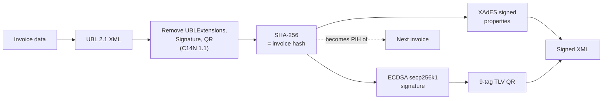
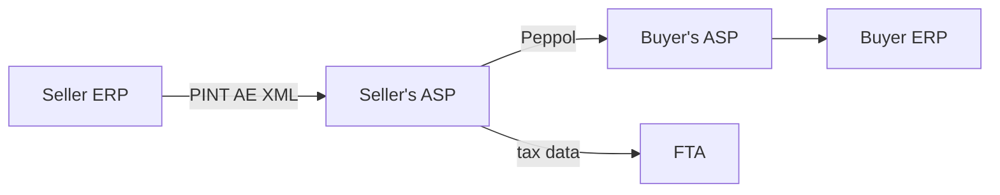

<div align="center">

# Gulf e-Invoicing Toolkit

**Open-source building blocks for Saudi ZATCA Phase 2 and UAE Peppol PINT AE e-invoices.**
One engine, three languages: JavaScript, Python and PHP, tested to produce identical bytes.

[](https://github.com/iFynx/gulf-e-invoicing/actions/workflows/ci.yml)
[](LICENSE)


[English](#english) · [العربية](#العربية) · [Live demos](#live-demos)

</div>

---

<a id="english"></a>

## Why this exists

E-invoicing is now mandatory or arriving fast across the Gulf, yet most developers meet it as a 100-page PDF, an XML schema and a black-box SDK. This repository shows the whole thing in readable code you can run in seconds:

| Package | What it does | Verified against |
|---|---|---|
| [`zatca/`](zatca) | Builds a **ZATCA Phase 2 simplified tax invoice** (UBL 2.1), computes the invoice hash, signs it with **ECDSA secp256k1**, writes the **XAdES** signature block and the **9-tag TLV QR code**, and chains invoices (ICV + PIH). | ZATCA developer-portal sandbox `/compliance/invoices`: `PASS` / `REPORTED` |
| [`uae-pint-ae/`](uae-pint-ae) | Builds a **UAE PINT AE tax invoice** (Peppol BIS Billing, UBL 2.1) and runs 15 rule checks named after their official PINT AE rule IDs. | Official **PINT AE 1.0.5 Schematron** with Saxon HE: 0 failed asserts, plus a negative control that must fail |

No network calls, no telemetry, no tracking. Your invoice data never leaves the machine that runs the code.

## Install

| Language | Package | Install |
|---|---|---|
| JavaScript / TypeScript | [`@ifynx/zatca-phase2`](zatca), [`@ifynx/uae-pint-ae`](uae-pint-ae) | `npm install @ifynx/zatca-phase2 @ifynx/uae-pint-ae` |
| Python 3.10+ | [`gulf-einvoicing`](python) | `pip install gulf-einvoicing` |
| PHP 8.1+ (Laravel, Symfony, WooCommerce) | [`ifynx/gulf-e-invoicing`](php) | `composer require ifynx/gulf-e-invoicing` |

All three ports are checked against the same [test vectors](test-vectors): the XML, invoice hash, XAdES properties and QR payload must match **byte for byte**. JavaScript and Python even produce the same signature bytes (RFC 6979 deterministic ECDSA with low-S); PHP signs through OpenSSL and is verified against the same key.

## Quick start

```sh
git clone https://github.com/iFynx/gulf-e-invoicing.git
cd gulf-e-invoicing

# Saudi Arabia: sign an invoice and print hash + QR
cd zatca && npm ci && npm run example

# UAE: build a PINT AE invoice and run the rule checks
cd ../uae-pint-ae && npm run example
```

<details>
<summary><b>Python</b></summary>

```python
from gulf_einvoicing import zatca, uae_pint_ae

signed = zatca.sign_invoice(invoice, zatca.load_private_key(pem), zatca.cert_info(cert_b64))
signed.xml, signed.qr, signed.invoice_hash

xml = uae_pint_ae.invoice_xml(uae_invoice)
```
</details>

<details>
<summary><b>PHP</b></summary>

```php
use IFynx\GulfEInvoicing\Zatca\{Invoice, Certificate};

$signed = Invoice::sign($invoice, Invoice::loadPrivateKey($pem), Certificate::fromBase64($certB64));
$signed->xml; $signed->qr; $signed->invoiceHash;

$xml = \IFynx\GulfEInvoicing\UaePintAe\Invoice::xml($uaeInvoice);
```
</details>

### ZATCA in 15 lines

```js
import { signInvoice, FIRST_PIH } from "@ifynx/zatca-phase2";

const signed = await signInvoice({
  number: 'INV-0001', uuid: crypto.randomUUID(),
  date: '2026-11-24', time: '09:30:00',
  counter: 1, pih: FIRST_PIH,              // invoice counter + previous invoice hash
  seller: { name: 'My Store', vat: '399999999900003', crn: '1010010000',
            street: 'King Fahd Road', building: '1234', district: 'Al Olaya',
            city: 'Riyadh', postal: '12211' },
  lines: [{ name: 'Arabic coffee', qty: 2, price: 12.5 }],
}, privateKey, certificate);

signed.xml;          // signed UBL invoice, ready to report
signed.qr;           // base64 TLV for the printed QR code
signed.invoiceHash;  // keep it: it is the PIH of your next invoice
```

### UAE PINT AE in 10 lines

```js
import { invoiceXml, check } from "@ifynx/uae-pint-ae";

const results = check(invoice);          // [{ id: 'IBR-132-AE', ok: true }, ...]
if (results.every((r) => r.ok)) {
  const xml = invoiceXml(invoice);       // hand this to your Accredited Service Provider
}
```

## How a ZATCA Phase 2 invoice is signed



The trickiest parts (and where most integrations fail) are documented inline in [`zatca/src/engine.js`](zatca/src/engine.js): the exact canonical bytes that get hashed, the indentation ZATCA's SDK expects inside the signed properties, DER encoding of the signature, and the certificate values that go into QR tags 8 and 9.

## How UAE e-invoices travel (five-corner model)



This package covers corner 1: producing an invoice that the official PINT AE rules accept before it reaches your Accredited Service Provider (ASP).

## Testing

```sh
cd zatca && npm test              # hash, signature, QR and XML checks (offline)
cd zatca && npm run sandbox       # live check against ZATCA's public sandbox
cd uae-pint-ae && npm test        # totals, rules, escaping (offline)
cd uae-pint-ae && npm run validate  # official PINT AE Schematron (needs Java 17+)
cd python && pip install -e ".[test]" && pytest   # Python port vs shared vectors
composer install && composer test                 # PHP port vs shared vectors
```

CI runs JavaScript on Node 20 and 22, Python 3.10 to 3.13, PHP 8.1 to 8.4 and the official UAE Schematron on every push. The ZATCA sandbox workflow runs on demand because it calls ZATCA's public API.

## Scope and honest limits

- **ZATCA:** simplified (B2C) tax invoices, standard rate 15% (category `S`), reporting profile. Standard (B2B) clearance invoices, credit/debit notes, exemptions and multi-rate invoices are not covered yet.
- **UAE:** standard tax invoice, 5% standard rate, AED. The browser checks are a subset of the official rules; the official Schematron in `validate/` is the source of truth.
- **Keys:** `zatca/keys/` holds a **public sandbox-only** demo key for a fictional store using ZATCA's own sample VAT number. It is public on purpose. Never use it for a real taxpayer. Generate your own key and onboard through Fatoora for production.
- This is engineering code, not tax advice. Check current requirements with ZATCA, the UAE Ministry of Finance / FTA, and your ASP.

## Live demos

Try both engines in your browser, in English and Arabic:

- 🇸🇦 ZATCA Phase 2 demo: <https://ifynx.com/zatca-e-invoicing-integration/>
- 🇦🇪 UAE PINT AE demo: <https://ifynx.com/uae-e-invoicing-integration/>

## Contributing

Issues and pull requests are welcome, especially: credit and debit notes, B2B clearance, zero-rated and exempt categories, more PINT AE rules in the browser checker, and test vectors from real ASP/ZATCA responses (with personal data removed). Please run `npm test` in the package you change.

## Need it in production?

This toolkit is maintained by **[iFynx](https://ifynx.com)**, a software company building web platforms, mobile apps and integrations for businesses in Saudi Arabia, the UAE and the wider Gulf. If you need ZATCA onboarding (CSR, CSID, clearance), PINT AE via an ASP, or e-invoicing inside your ERP, POS or app, [talk to us](https://ifynx.com/contact/).

---

<a id="العربية"></a>

<div dir="rtl">

## العربية

### ما هذا المشروع؟

**مجموعة أدوات مفتوحة المصدر للفوترة الإلكترونية في الخليج**، بثلاث لغات: JavaScript و Python و PHP، تعمل بدون أي خادم:

| الحزمة | ماذا تفعل | تم التحقق منها عبر |
|---|---|---|
| [`zatca/`](zatca) | تبني **فاتورة ضريبية مبسطة للمرحلة الثانية من هيئة الزكاة والضريبة والجمارك (فاتورة)** بصيغة UBL 2.1، وتحسب بصمة الفاتورة (hash)، وتوقّعها بـ **ECDSA secp256k1**، وتكتب كتلة توقيع **XAdES** و**رمز QR بتسعة حقول TLV**، وتربط الفواتير بعدّاد ICV والبصمة السابقة PIH. | بيئة الاختبار الرسمية للمطورين لدى الهيئة: `PASS` / `REPORTED` |
| [`uae-pint-ae/`](uae-pint-ae) | تبني **فاتورة ضريبية إماراتية بصيغة PINT AE** (Peppol) وتفحص 15 قاعدة بأرقامها الرسمية. | **قواعد Schematron الرسمية لـ PINT AE 1.0.5**: صفر أخطاء، مع اختبار سلبي يجب أن يفشل |

لا اتصال بالإنترنت، ولا تتبّع، ولا تخرج بيانات فواتيرك من جهازك.

### البدء السريع

```sh
npm install @ifynx/zatca-phase2 @ifynx/uae-pint-ae   # JavaScript
pip install gulf-einvoicing                          # Python
composer require ifynx/gulf-e-invoicing              # PHP
```

النسخ الثلاث تُختبر على نفس الفواتير المرجعية، ويجب أن تُخرج نفس الـ XML ونفس البصمة ونفس رمز QR حرفاً بحرف.

### الحدود بصراحة

- **السعودية:** الفواتير المبسطة (B2C) بنسبة 15% فقط. الفواتير القياسية (B2B) بنظام الاعتماد المسبق (Clearance) وإشعارات الدائن والمدين لم تُضف بعد.
- **الإمارات:** فاتورة ضريبية قياسية بنسبة 5% بالدرهم. المرجع النهائي هو ملفات Schematron الرسمية في مجلد `validate/`.
- **المفاتيح:** المفتاح في `zatca/keys/` مفتاح تجريبي **عام** لبيئة الاختبار فقط، لمتجر وهمي برقم ضريبي نموذجي من الهيئة. لا تستخدمه لأي منشأة حقيقية.
- هذا كود هندسي وليس استشارة ضريبية.

### جرّبها مباشرة

- 🇸🇦 تجربة الفوترة السعودية: <https://ifynx.com/ar/zatca-e-invoicing-integration/>
- 🇦🇪 تجربة الفوترة الإماراتية: <https://ifynx.com/ar/uae-e-invoicing-integration/>

### تحتاجها في مشروعك؟

يطوّر هذا المشروع فريق **[آيفينيكس](https://ifynx.com/ar/)**، شركة برمجيات تبني منصات الويب وتطبيقات الجوال والتكاملات للشركات في السعودية والإمارات والخليج. إذا كنت تحتاج ربط نظامك أو نقطة البيع أو تطبيقك بمنصة فاتورة، أو إصدار فواتير PINT AE عبر مزوّد خدمة معتمد، [تواصل معنا](https://ifynx.com/ar/contact/).

</div>

---

<div align="center">

MIT © 2026 [iFynx Integrated Solutions P.S.C.](https://ifynx.com) · Made in Palestine for the Gulf

</div>
